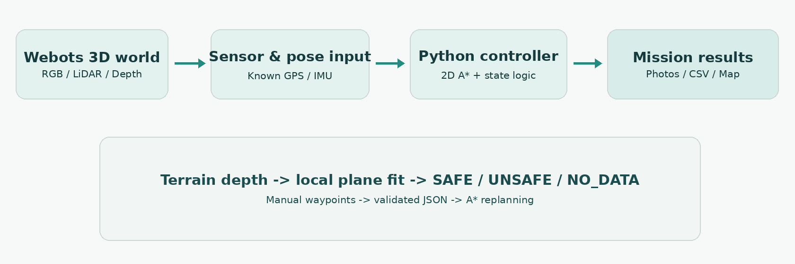
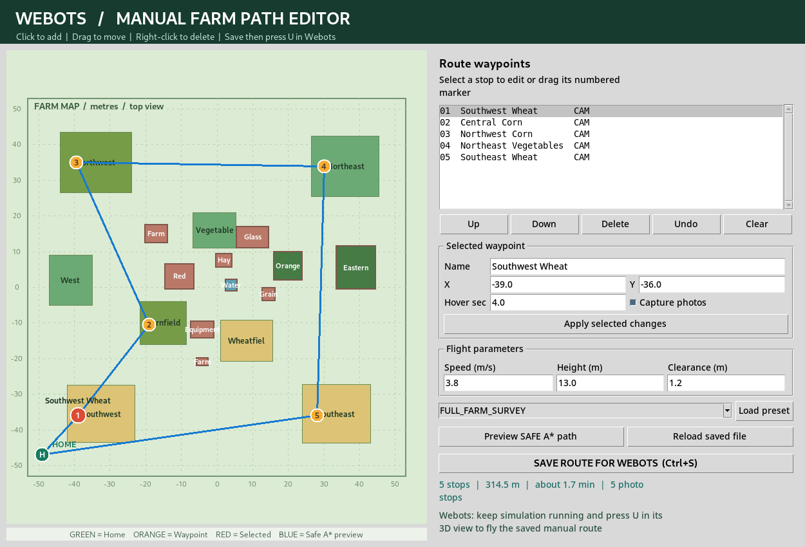

<div align="center">

# 🚁 Bio-Inspired Hybrid UAV

### Legged · Wheeled · Flying agricultural survey drone — simulated in Webots


**A single UAV that rolls on wheels, walks on four legs, then takes off and surveys a farm — all inside one Webots world.**


<i>Planned farm survey route — 17 stops, 0.75 m planning grid.</i>

<br><br>

[Client demo](#one-click-client-demo) |
[🚀 Quick Start](#-quick-start) ·
[🌍 Worlds](#-worlds) ·
[🎮 Controls](#-controls) ·
[📁 Project Structure](#-project-structure) ·
[🧪 Testing](#-testing) ·
[📚 Documentation](#-documentation) ·
[⚠️ Scope & Limitations](#-scope-and-limitations)

</div>

## One-click client demo

Follow the steps in order on Windows. The launcher runs the farm survey first
and then opens a separate LIO-SAM obstacle-avoidance arena.

### 1. Open the project and check the tools

Open PowerShell in the repository root, where `RUN_CLIENT_DEMO.bat` and the
`Drone` folder are visible. Install Webots R2025a and Python 3.9 or newer.
Start the Linux Docker engine used by the `kiri` context, then check it from
the same PowerShell window.

```powershell
python --version
docker context ls
docker --context kiri info --format '{{.ServerVersion}}'
```

If Webots cannot find Python, set the Python command in **Tools > Preferences >
General** and reopen the world. If the launcher cannot find Webots in its
default location, set `$env:WEBOTS_EXE` to the full path to `webots.exe` before
running it. For a local simulation without the two-stage ROS workflow, use
[Drone/RUN_DEMO.bat](Drone/RUN_DEMO.bat).

### 2. Prepare the ROS 2 container once

Check whether the client container already exists.

```powershell
docker --context kiri inspect --format '{{.State.Status}} {{json .HostConfig.PortBindings}}' uav-liosam-nov27
```

The expected status before launch is `created` or `exited`, with container
port `15882/tcp` mapped to host port `15882`. The supplied setup binds the
host port to `127.0.0.1`. Close any other sensor receiver using that port.
If the container belongs to a previous active demo, stop that demo first.

On a fresh workstation, run the following build and create commands once.
If the required images are already available, reuse them and run only
`docker create`. The launcher starts the container itself.

```powershell
docker --context kiri build -t uav-fast-livo2-check 'https://github.com/U-AMC/FAST-LIVO2-ROS2.git#a09599a288c56b832114d7ad9e898248a4111d9e'
docker --context kiri build -f Drone/integration/ros2/Dockerfile.lio-sam -t uav-lio-sam:humble Drone/integration/ros2
docker --context kiri create --name uav-liosam-nov27 -p 127.0.0.1:15882:15882 uav-lio-sam:humble sleep infinity
```

See the [LIO-SAM setup notes](Drone/docs/lio-sam-camera-validation.md) for the
image dependencies and the [client launcher guide](Drone/docs/CLIENT_DEMO.md)
for the local launch workflow.

### 3. Start the demo and open the camera views

Double-click [RUN_CLIENT_DEMO.bat](RUN_CLIENT_DEMO.bat), or run this command
from the repository root.

```powershell
.\RUN_CLIENT_DEMO.bat
```

The launcher starts the ROS 2 container, builds the bridge and waits for
LIO-SAM before opening the farm. Leave the launcher console open. The default
run uses real-time mode, which gives you time to watch and interact with the
drone. For quicker verification, use `.\RUN_CLIENT_DEMO.bat --mode fast`.
The arena still runs in real time. Add `--no-dashboard` if you want only the
Webots windows. The HTML dashboard is still saved on disk.

The launcher restores two separate **native Webots camera windows** every
time it opens either stage. The main Webots window shows the world and path.
The two camera windows show what the drone sees.

| Stage | Front view | Bottom view |
| --- | --- | --- |
| Farm survey | `slam_camera` | `survey_camera` |
| Physics arena | `oak_rgb` | `bottom_camera` |

If you close a camera window during a run, double-click its camera overlay
in the Webots 3D viewport to open it again. The browser sensor dashboard
updates separately and shows telemetry and terrain data.

### 4. Follow the farm mission from departure to parking

1. **Roll and walk.** The drone starts on the home pad, drives a short distance
   on its wheels and transitions to walking. Watch for `ROLLING` and `WALKING`
   in the console.
2. **Take off.** The drone transitions through `TO_FLIGHT` and climbs to the
   survey altitude. The default is 13 m. The front window shows the upcoming
   path and the bottom window shows the ground beneath the drone.
3. **Survey the farm.** The drone follows the planned route, hovers at the
   17 survey stops and captures front and downward images. The dashboard shows
   telemetry while the console reports flight state and path changes.
4. **Return home and land.** After the survey, the drone flies back to the
   home pad and descends. The launcher records the touchdown position.
5. **Drive after touchdown.** The drone switches back to wheel mode and
   follows the **green ground route** to a nearby waypoint. It parks there
   without another takeoff. The result records the post-landing wheel distance
   and the final parked position.

The farm uses Supervisor-kinematic movement and Webots pose. Its flight
planner uses a known map and live scene collision footprints. The wheel
planner uses bounded-curvature Hybrid A* to generate a drivable path.

### 5. Test an obstacle in flight or on the ground

1. Wait until the drone is flying or following the green wheel route after
   touchdown. Use the Webots **Pause** button so you can edit the scene.
2. Insert or move a top-level Webots `Solid` with a supported collision
   `boundingObject`, such as a `Box`. Place it ahead on the active path
   with enough room for the drone to turn. At the default flight altitude,
   a 2 m box centered at Z = 13 m crosses the flight corridor. For a ground
   test, center a 2 m box at about Z = 1 m on the green route.
3. Resume Webots. In flight, look for `[FARM OBSTACLE] Route changed`. On the
   ground, look for `[GROUND REPLAN] Route changed` and watch the green route
   redraw around the box.
4. Check that the drone keeps its ground destination. If the route is
   blocked, it holds position. Move the obstacle away to let the planner
   look for a clear route again.

The obstacle needs collision geometry. Visual-only shapes, unsupported
meshes and nested objects are outside this scene-geometry check. Avoid
placing a new object directly on an occupied drone position.

### 6. Watch the physics arena

When the farm drone parks, the launcher closes the farm world, restarts the
ROS stack and opens the physics arena automatically. Both camera windows
reopen for the arena. The red obstacle moves across the route without user
input.

The arena uses LIO-SAM LiDAR and IMU odometry for navigation and uses
simulated stereo camera and LiDAR inputs for obstacle avoidance. Watch the
drone adjust its path around the moving obstacle and approach its goal. The
arena scores arrival, replans, contact count, minimum clearance and final
3D goal error.

### 7. Finish or stop and review the evidence

The launcher writes a summary when both stages finish. To end the demo early,
double-click [STOP_CLIENT_DEMO.bat](STOP_CLIENT_DEMO.bat). It signals the active
launcher to shut down its Webots and ROS processes.

Open the newest folder under `client-demo-sessions/`. The launcher prints that
folder at startup.

| File | What to look for |
| --- | --- |
| `session-result.json` | Overall outcomes for the farm and arena. |
| `farm/farm-result.json` | Photos, wheel and walking distances, touchdown position, distance driven after landing and final parked position. |
| `farm/dashboard.html` | The last farm dashboard view. |
| `lio-sam/result.json` | Arrival status, contact count, replans, clearance and final goal error. |
| `farm/webots.log`, `lio-sam/webots.log`, `ros.log` and `ros.jsonl` in each stage | Controller and ROS evidence for troubleshooting or review. |

If the launcher stops before opening Webots, check the launcher console and
the session summary for the startup error. Confirm Webots R2025a, the Docker
context, the container state and the port mapping from Steps 1 and 2.

### Measured results

| Verification | Result |
| --- | --- |
| Two-stage client run | The farm captured 34 photos, returned home and drove **4.80 m after touchdown**. The arena arrived with **zero contacts** and **0.067 m** final goal error. This run predates the longer ground detour below. |
| Live farm flight detour | A 2 m box inserted after takeoff changed the flight route from 2 to 4 waypoints. The drone reached the survey stop with at least **0.52 m** clearance from the box. |
| Live farm ground detour | A 2 m box inserted during post-landing driving triggered a new green route. The drone drove **19.75 m** after touchdown and parked, with at least **1.26 m** clearance from the box. |
| Arena acceptance matrix | **18/18** recorded runs passed across camera-only, LiDAR-only and combined avoidance, with static, moving and multiple obstacles. Minimum clearance was **0.973 m** and maximum final goal error was **0.094 m**. |

The insertion trials used temporary copies of the farm world. Local results are
in `client-demo-sessions/20261128-164352-929727/session-result.json`,
`client-demo-sessions/inserted-obstacle-final/verification.json` and
`client-demo-sessions/muqadder-ground-detour/verification.json`. The archived
[client demonstration report](Drone/docs/CLIENT_DEMO_REPORT.md) and
[v5 flight matrix](Drone/docs/evidence/flight-matrix-v5/README.md) give the earlier
acceptance results and source revisions. The separate Muqadder reference copy,
when present locally under `Drone-muqadder/`, has its own full perimeter
patrol. The main client demo uses a shorter post-landing route.

---

## ✨ Highlights

| | |
| --- | --- |
| 🦿 **Three locomotion modes** | Roll on wheels, walk on four legs, or fly — switch mid-mission with a single key. |
| 🗺️ **Autonomous navigation** | Known-map 2D A* planning, waypoint editing, obstacle placement and live route replanning. |
| 📸 **4K survey capture** | Dual survey cameras shoot **3840 × 2160** frames at every stop; a full mission writes ~35 images. |
| 🌾 **17-stop farm mission** | Rolls to an inspection point, grabs a ground image, takes off, surveys 17 stops, returns, lands and drives to a ground waypoint in the client demo. |
| 🛬 **Terrain-aware landing** | Depth-based ground assessment returns `SAFE` / `UNSAFE` / `NO_DATA` before allowing descent. |
| 📡 **Live sensor bridge** | TCP stream of simulated IMU, LiDAR, RGB and GPS to a local receiver on port `15882`. Webots saves the HTML dashboard separately. |
| 🔁 **ROS 2 ready** | Optional `drone_ros_bridge` package for Ubuntu / WSL2 Humble publishing. |
| ✅ **Offline regression suite** | Planning, routes, perception, telemetry and wheel/leg logic run without launching Webots. |

---

## 🚀 Quick Start

**Requirements:** Windows 11 · [Webots R2025a](https://cyberbotics.com/) · Python 3 (plus Tkinter for the route editor)

```powershell
# 1. Clone
git clone https://github.com/jakir-hossen-4928/BioInspiredHybridUAV.git
cd BioInspiredHybridUAV

# 2. Verify the offline suite
python -m unittest discover -s Drone/tests -v

# 3. Run the demo
.\Drone\RUN_DEMO.bat
```

> 💡 Or open [Drone/worlds/hybrid_wheels.wbt](Drone/worlds/hybrid_wheels.wbt) directly in Webots via **File → Open World**, then press **Reset** and **Real-time**.

### Docker setup for ROS 2, FAST-LIVO2 and Hybrid A*

Use Windows PowerShell from the cloned repository root, with Webots R2025a, Python 3 and Docker running Linux containers. Close any TCP monitor using port `15882`. Build the tested U-AMC FAST-LIVO2 revision and start a local Humble container. The first build downloads and compiles the estimator dependencies.

```powershell
docker build -t farm-fast-livo:humble "https://github.com/U-AMC/FAST-LIVO2-ROS2.git#a09599a288c56b832114d7ad9e898248a4111d9e"
docker run -d --name farm-livo -p 127.0.0.1:15882:15882 farm-fast-livo:humble sleep infinity
docker cp Drone/ros2_ws/src farm-livo:/tmp/src
docker cp Drone/integration/ros2/prepare_fast_config.py farm-livo:/tmp/prepare_fast_config.py
docker exec farm-livo bash -c 'apt-get update && apt-get install -y --no-install-recommends ros-humble-demo-nodes-cpp python3-yaml'
docker exec farm-livo bash -c 'source /opt/ros/humble/setup.bash && source /fast_livo_ws/install/setup.bash && cd /tmp && colcon build --packages-select drone_ros_bridge && python3 prepare_fast_config.py --upstream /fast_livo_ws/src/fast_livo --output /tmp/farm-config'
```

Start the bridge and estimator in the first terminal. For later sessions, start the existing container with `docker start farm-livo` and repeat this launch command.

```powershell
docker exec -it farm-livo bash -c 'source /opt/ros/humble/setup.bash && source /fast_livo_ws/install/setup.bash && source /tmp/install/setup.bash && ros2 launch drone_ros_bridge fast_livo2.launch.py mid360_params_file:=/tmp/farm-config/mid360_webots.yaml camera_params_file:=/tmp/farm-config/camera_webots.yaml use_rviz:=false'
```

When the receiver reports it is listening, open a second PowerShell terminal in the repository root. Run the launcher below and press Play in Webots. Look for `[HYBRID A*] rolling poses:` in the controller console. Check each ROS topic rate in turn, pressing Ctrl+C between checks.

```powershell
.\Drone\RUN_ROS2_DEMO.bat
docker exec -it farm-livo bash -c 'source /opt/ros/humble/setup.bash && ros2 topic hz /aft_mapped_to_init'
docker exec -it farm-livo bash -c 'source /opt/ros/humble/setup.bash && ros2 topic hz /cloud_registered'
```

Restart the estimator after resetting the Webots clock. To finish, press Ctrl+C in the launch terminal and run `docker stop farm-livo`.

**Kiri on Windows.** Start Kiri and check `docker context show`. The validation run used the `kiri` context. If a different context is active, use `docker context use kiri` before running the Docker commands above.

**Webots and ROS 2 results, 24 November 2026.** The wheel mission reached `LANDED` at 196.024 simulated seconds, with 27,107 bridge packets sent and zero reported drops. The controller used the Supervisor pose. FAST-LIVO2 produced odometry and registered clouds, but its airborne position diverged. Six near-synchronous odometry/reference pairs from 5.208 to 123.288 s had a rigidly aligned position RMSE of **1,036.5 m** (no scale adjustment, maximum timestamp difference 0.208 s). The [six checkpoint pairs](Drone/docs/fast_livo2_webots_checkpoints.jsonl) include the original timestamps and positions in metres. The [later full-trajectory benchmark](Drone/docs/FAST_LIVO2_VALIDATION.md) used 624 samples. Surveyed FAST-LIVO2 map accuracy remains open.

The [LIO-SAM and forward obstacle tests](Drone/docs/lio-sam-camera-validation.md) cover the alternate ROS 2 estimator and the OAK depth and LiDAR inputs to airborne replanning.

**State-Augmented Hybrid A*.** For a requested flight-to-walk transition the planner searches continuous ground arcs, horizontal flight segments and vertical transitions at approved cells. Each pose stores position, yaw and mode. Flight and walking each use a fixed height, with collision checks against the inflated planar grid. The controller accepts a descent only at its terrain-screened current site. Tests exercise both search directions, height changes and rejection without an approved site. In a separate Webots walking-world run, the controller descended from 13.0 m to 0.6 m, walked to the inspection point, resumed flight and landed at 218.024 simulated seconds. The autonomous wheel survey uses a separate rolling planner and flight waypoint controller. Full 3D clearance and integrated research-design acceptance remain open.


### Launcher cheat sheet

| Script | Does what |
| --- | --- |
| [RUN_CLIENT_DEMO.bat](RUN_CLIENT_DEMO.bat) | Two-stage client simulation with native front and bottom Webots camera windows |
| [STOP_CLIENT_DEMO.bat](STOP_CLIENT_DEMO.bat) | Stops the active client session |
| [RUN_DEMO.bat](Drone/RUN_DEMO.bat) | Main wheel-drive → flight demonstration |
| [RUN_OFFLINE_TESTS.bat](Drone/RUN_OFFLINE_TESTS.bat) | Runs the full offline test suite from `Drone/` |
| [RUN_ROS2_DEMO.bat](Drone/RUN_ROS2_DEMO.bat) | Opens `hybrid_wheels_ros2.wbt` with the ROS 2 bridge |
| [editor.bat](Drone/editor.bat) | Map-based waypoint editor (save, then press `U` in Webots) |
| [sensors.bat](Drone/sensors.bat) | Live sensor dashboard in the browser |
| [photos.bat](Drone/photos.bat) | High-resolution camera world (GPU heavy) |
| [start.bat](Drone/start.bat) | Launch the base farm scene |
| [rebuild.bat](Drone/rebuild.bat) | ⚠️ Regenerates world files from geometry scripts — backs up to `world_backups/` first |
| [OPEN_SOURCE_CODE.bat](Drone/OPEN_SOURCE_CODE.bat) | Opens the project in VS Code |

---

## 🌍 Worlds

All under [Drone/worlds/](Drone/worlds/).

| World | Locomotion | What starts with |
| --- | --- | --- |
| [hybrid_wheels.wbt](Drone/worlds/hybrid_wheels.wbt) | 🛞 Wheels → ✈️ Flight | Wheel drive, inspection, flight survey — **the default demo** |
| [hybrid.wbt](Drone/worlds/hybrid.wbt) | 🦿 Legs → ✈️ Flight | Four-leg walking, inspection, flight survey |
| [farm.wbt](Drone/worlds/farm.wbt) | ✈️ Flight only | Survey with the default viewpoint |
| `overview.wbt`, `follow.wbt`, `closeup.wbt`, `top.wbt`, `photos.wbt` | ✈️ Flight only | Farm survey camera and viewpoint variants |
| [livo2.wbt](Drone/worlds/livo2.wbt), `livo2_fast.wbt` | ✈️ Flight only | FAST-LIVO2 sensor-stream variants |
| [hybrid_ros2.wbt](Drone/worlds/hybrid_ros2.wbt), [hybrid_wheels_ros2.wbt](Drone/worlds/hybrid_wheels_ros2.wbt) | 🦿/🛞 → ✈️ | Same demos with the ROS 2 bridge enabled |

The [foot-force validation world](Drone/validation/worlds/foot_force_validation.wbt) runs as a separate Webots project. It exercises physical landing and walking on a controlled test rig.

---

## 🎮 Controls

Click the 3D view while the simulation runs, then press keys.

### Flight & mission

| Key | Action |
| --- | --- |
| `W` / `I` | Walk / take off and resume flight in the hybrid worlds |
| `T` | Roll in the wheel worlds · take off from landed in flight-only worlds |
| `M` / `N` / `G` | Cycle mission preset / skip a survey stop / return home |
| `O` / `R` / `V` | Toggle mapped test obstacle / replan / toggle route overlay |
| `D` / `Y` / `Z` | Toggle hybrid sonar handling / inspect terrain / request terrain-checked landing |
| `+` / `−` and `H` / `J` | Adjust flight speed and altitude |
| `U` | Reload the saved manual route |

### Cameras & capture

| Key | Action |
| --- | --- |
| `C` / `B` | Capture downward / front image in the configured format |
| `K` / `F` | Capture downward / front PNG |
| `A` / `P` | Toggle automatic photos / pause or resume UAV motion |

> 💡 Air-to-ground mode requests depend on the site's depth assessment and an available ground route. Use `hybrid.wbt` to demonstrate walking from startup. Close camera overlays when they hide the farm.

---

## 📁 Project Structure

```
BioInspiredHybridUAV/
├── README.md
├── .gitignore
└── Drone/
    ├── controllers/
    │   ├── drone/          # drone.py · planner.py · hybrid_planner.py
    │   │                   # terrain_perception.py · console_telemetry.py
    │   │                   # fast_livo_stream.py · livo_protocol.py
    │   │                   # settings.json · scene.json · manual_mission.json
    │   ├── hybrid/         # hybrid.py      — four-leg walking
    │   └── wheels/         # wheels.py      — wheel-driven rolling
    ├── worlds/             # 12 Webots .wbt worlds
    ├── textures/           # 4K farm-wood and terrain textures
    ├── tools/              # path_editor.py · farm_geometry.py
    │                       # create_worlds.py · add_wheels_worlds.py
    ├── tests/              # offline unittest suite
    ├── docs/               # 15 markdown guides + screenshots + evidence
    ├── integration/        # monitor.py / monitor.bat — TCP sensor bridge
    ├── ros2_ws/src/drone_ros_bridge/   # ROS 2 Humble package
    ├── captures/           # per-session images, telemetry, galleries
    ├── dashboard.html      # live sensor dashboard (refreshed during runs)
    └── *.bat               # 20+ one-click launchers
```

---

## ⚙️ Configuration

| File | Controls |
| --- | --- |
| [settings.json](Drone/controllers/drone/settings.json) | Speed, altitude, clearance, photo options, sensor streaming, landing thresholds |
| [scene.json](Drone/controllers/drone/scene.json) | Field boundaries, home point, mapped obstacles, survey stops, mission presets |
| [manual_mission.json](Drone/controllers/drone/manual_mission.json) | Custom route written by the waypoint editor |

**Default survey parameters** — 0.75 m planning grid · 1.2 m clearance · 3.8 m/s flight speed · 13 m altitude · 4 s waypoint holds.

Reload the world after changing any of these.

### Outputs

Each run writes to [Drone/captures/](Drone/captures/):

- `MISSION_GALLERY.html` — browsable photo gallery
- `photo_manifest.csv` — stop IDs and camera names
- `CONSOLE_TELEMETRY.jsonl` / `SENSOR_TELEMETRY.csv` — full telemetry
- `hybrid_status.json` — mode transitions and final landing
- 4K PNG/JPG frames, tagged `GROUND_INSPECTION` for the pre-flight image

> ⚠️ A default hybrid survey uses several hundred MB. `capture_front_also` and `photo_format` control future output size — archive old runs you no longer need.

---

## 🧪 Testing

The latest workspace run collected 94 tests. It passed 91, including the
camera-window restore and ground obstacle detour regressions. Three checks
flag existing local edits to the farm world involving its sensor declarations,
formatting and generator reproducibility.

```powershell
python -m unittest discover -s Drone/tests -v
```

| Metric | Value |
| --- | --- |
| Coverage | Navigation, perception, routes, hybrid modes, wheel arcs, telemetry, sensor transport, ROS 2 packaging and local estimator math |
| Tests | Run the suite above. The calibration configuration test skips when PyYAML is unavailable. |
| Runtime | ~5 s |
| Webots required | No — uses mocked Webots objects and synthetic depth arrays |

| Module | Covers |
| --- | --- |
| [test_navigation.py](Drone/tests/test_navigation.py) | A* occupancy-grid planning and replanning |
| [test_perception.py](Drone/tests/test_perception.py) | Depth-based ground-plane fit and landing decisions |
| [test_routes.py](Drone/tests/test_routes.py) | Manual waypoint validation and mission presets |
| [test_hybrid.py](Drone/tests/test_hybrid.py) / [test_wheels.py](Drone/tests/test_wheels.py) | Mode transitions for walking and rolling |
| [test_console_telemetry.py](Drone/tests/test_console_telemetry.py) | Telemetry logging and state formatting |
| [test_livo_stream.py](Drone/tests/test_livo_stream.py) | FAST-LIVO2 sensor stream framing |
| [test_ros2_package.py](Drone/tests/test_ros2_package.py) | ROS 2 bridge packaging (skips without PyYAML) |

See [Drone/docs/testing.md](Drone/docs/testing.md) for what these tests do **not** prove.

---

## 📸 Screenshots

| Architecture | Route plan | Path editor |
| --- | --- | --- |
|  |  |  |

| Hybrid planning preview |
| --- |
|  |

> ℹ️ Full-resolution survey frames from real runs live in [Drone/captures/](Drone/captures/) — open the latest `MISSION_GALLERY.html` to browse them.

---

## 📚 Documentation

### 🔧 Getting started
| Guide | Description |
| --- | --- |
| [Drone/docs/guide.md](Drone/docs/guide.md) | Setup, launchers, editable parameters, output data |
| [Drone/README_START_HERE.txt](Drone/README_START_HERE.txt) | Original merged-project walkthrough |
| [Drone/docs/testing.md](Drone/docs/testing.md) | What the test suite verifies — and what it does not |
| [Drone/README_VALID_ZIPS.txt](Drone/READ_ME_VALID_ZIPS.txt) | Integrity notes for the source archives |

### 🦿 Locomotion & worlds
| Guide | Description |
| --- | --- |
| [Drone/README_WHEELS.md](Drone/README_WHEELS.md) | Wheel-drive mode |
| [Drone/docs/FLIGHT_WALK_SETUP.md](Drone/docs/FLIGHT_WALK_SETUP.md) | Flight and walking setup |
| [Drone/docs/WHEEL_LEGS_DEMO.md](Drone/docs/WHEEL_LEGS_DEMO.md) | Combined wheel + leg demonstration |
| [Drone/docs/WHEEL_QA_SUMMARY.md](Drone/docs/WHEEL_QA_SUMMARY.md) | Wheel-mode QA notes |

### 📡 Sensors, ROS 2 & SLAM
| Guide | Description |
| --- | --- |
| [Drone/docs/specifications.md](Drone/docs/specifications.md) | Per-sensor status: what works, what is approximated, what is missing |
| [Drone/docs/SENSOR_MOUNTS.md](Drone/docs/SENSOR_MOUNTS.md) | Sensor placement |
| [Drone/docs/ROS2_CONNECTION.md](Drone/docs/ROS2_CONNECTION.md) | Ubuntu/WSL2 ROS 2 bridge setup |
| [Drone/README_ROS2.md](Drone/README_ROS2.md) | ROS 2 overview |
| [Drone/README_CONSOLE_DEMO.txt](Drone/README_CONSOLE_DEMO.txt) | Console-only demonstration |
| [Drone/docs/FAST_LIVO2_SETUP.md](Drone/docs/FAST_LIVO2_SETUP.md) | External FAST-LIVO2 estimator setup |
| [Drone/docs/FAST_LIVO2_VALIDATION.md](Drone/docs/FAST_LIVO2_VALIDATION.md) | What has and has not been validated |
| [Drone/docs/4k_quality.md](Drone/docs/4k_quality.md) | 4K texture and image quality notes |

### 📈 Project status
| Guide | Description |
| --- | --- |
| [Drone/docs/PROGRESS_2026-11-21.md](Drone/docs/PROGRESS_2026-11-21.md) | Latest progress log |
| [Drone/docs/PROFESSOR_STATUS.md](Drone/docs/PROFESSOR_STATUS.md) | Supervisor-facing status |
| [Drone/docs/UPGRADE_NOTES.md](Drone/docs/UPGRADE_NOTES.md) | Upgrade notes |
| [Drone/docs/report.docx](Drone/docs/report.docx) | Word-format project report |

---

## 🧭 Optional Sensor Bridge

```powershell
.\Drone\integration\monitor.bat
```

The TCP monitor listens on `127.0.0.1:15882`, reports IMU, LiDAR, RGB and GPS counts, and writes samples to [Drone/integration/recordings/](Drone/integration/recordings/).

- ROS 2 publishing → [Drone/docs/ROS2_CONNECTION.md](Drone/docs/ROS2_CONNECTION.md)
- External estimator → [Drone/docs/FAST_LIVO2_SETUP.md](Drone/docs/FAST_LIVO2_SETUP.md)
- Source → [Drone/ros2_ws/src/drone_ros_bridge/](Drone/ros2_ws/src/drone_ros_bridge/)

A disconnected receiver never stops the local mission.

---

## ✅ Verification on This PC

| Webots run | First logged landing | Survey output |
| --- | --- | --- |
| 🛞 Wheel drive → ✈️ flight | 196.05 simulated seconds, **0.091 m** from home | 17 stops, 35 decodable 3840 × 2160 PNGs |
| 🦿 Leg walking → ✈️ flight | 198.05 simulated seconds, **0.091 m** from home | 17 stops, 35 decodable 3840 × 2160 PNGs |

The wheel run confirms the corrected 0.60 m model landing height and the `GROUND_INSPECTION` label. The walking run predates those two changes. The local TCP monitor received live IMU, LiDAR, RGB and GPS data and wrote a camera sample plus a point cloud.

### Delivery verification — 26 November 2026

| Area | Result |
| --- | --- |
| Offline verification | **77/77** tests passed, including route and landing logic, sensor transport and force-trace replay. |
| Farm walking and rolling missions | **21/21** live checks passed. The walking mission returned at **198.048 s** and the rolling mission at **196.048 s**, each **0.091 m** horizontally from home. Each mission produced 35 decodable 3840 × 2160 PNGs across 17 survey stops plus a ground inspection. The depth-based classifier emitted `SAFE`, `UNSAFE` and `NO_DATA`. |
| Binary foot contact | All four bumper devices switched from 0 to 1 and back during a controlled height probe. They stayed at 0 in both normal missions, so the normal mission does not demonstrate bumper-triggered touchdown. |
| Foot-force rig | **58/58** landing and walking checks and **24/24** signed axis comparisons on the four individual pads passed. See the section below. |
| ROS 2 and FAST-LIVO2 | The ROS 2 wheel mission completed at **196.024 s** with **27,107** TCP packets sent and zero reported drops. The external estimator published odometry, a path and registered point clouds. **Localization accuracy failed**. Across 624 paired observations the rigidly aligned position RMSE was **7,654.23 m**. |

The farm runs assess controller and simulation behavior. They do not establish full 3D obstacle clearance, terrain false-safe rates, metric map accuracy, or physical flight, traction, contact loads or energy performance. [Run results](Drone/docs/evidence/delivery_2026-11-26.json) · [FAST-LIVO2 trajectory and method](Drone/docs/FAST_LIVO2_VALIDATION.md)

### Foot-force validation in Newtons

Webots R2025a ran a **3.900 kg free-body quadruped** through a **75 mm vertical drop**, a settled stand, **eight motor-driven crawl steps**, and two static horizontal load cases. Each leg has motorized stride and lift joints and a colliding pad with a `force-3d` sensor. An empty lookup table makes `getValues()` return Newtons. The controller logs all four three-axis vectors in their local frames and transforms them to the world frame (ENU, +Z up) at **250 Hz**. The Supervisor observes poses and applies the prescribed horizontal loads during the static load cases.

The four farm-world variants also use empty lookup tables for their foot-force devices, so Webots reports the raw values directly in Newtons. A live device probe confirmed all four settings in the walking world. Force accuracy was tested on the separate physics-driven rig.

| Check | Webots result |
| --- | --- |
| Free-fall baseline | All four force magnitudes were effectively 0 N before contact |
| Landing | First pad contact at **0.124 s**. Combined vertical peak **719.036 N** at **0.128 s**. Net vertical impulse **4.623 N·s**, matching the momentum-change reference to within **0.05 N·s** |
| Standing on four feet | **37.278 N** combined raw vertical support and **9.3195 N** per foot |
| Walking | **0.160 m** forward over eight steps. Each swing foot cleared the floor by at least **58.3 mm** in its measurement window, stayed below **0.246 N** in magnitude, and reloaded to **9.19–9.28 N** mean vertical force |
| Horizontal reference loads | Separate **+6.000 N** chassis loads along world X and world Y produced mean reactions of **−5.999 N** along the loaded axis with negligible cross-axis response |
| Repeatability | **58/58 checks passed** on two runs with byte-identical CSV traces. Each trace contains **4,250 timestamps** |

The unloaded sensor pads account for 0.100 kg of the rig. The pad sensors report the reaction at their fixed attachments, so the standing reference for the raw sum is `(3.900 − 0.100) × 9.81 = 37.278 N`. The small swing reading includes pad weight and inertia. The impact peak depends on contact settings and the 4 ms physics step. The results cover this level-floor test rig and its prescribed loads. The farm missions use Supervisor kinematics, and physical sensor calibration remains open.

**Reproduce on Windows** from the repository root with Webots R2025a and Python 3 installed.

```powershell
$env:FOOT_FORCE_OUTPUT = Join-Path $env:TEMP "webots-foot-force-$([guid]::NewGuid())"
$world = (Resolve-Path 'Drone/validation/worlds/foot_force_validation.wbt').Path
$webots = 'C:/Program Files/Webots/msys64/mingw64/bin/webots.exe'
$run = Start-Process -FilePath $webots -ArgumentList @('--batch', '--mode=fast', '--no-rendering', ('"{0}"' -f $world)) -WindowStyle Hidden -PassThru -Wait
Get-Content (Join-Path $env:FOOT_FORCE_OUTPUT 'foot_force_summary.json')
$run.ExitCode
```

The run writes the raw CSV and check results to `FOOT_FORCE_OUTPUT`; exit code 0 means all checks passed. For an interactive run, open the validation world in Webots and select Real-time. The controller completes automatically after 17 simulated seconds. With no output override, files go to `~/webots-foot-force/`.

Download the [full CSV trace (gzip)](Drone/docs/evidence/foot-force/foot_force.csv.gz) and [machine-readable validation results](Drone/docs/evidence/foot-force/foot_force_summary.json). The CSV fields ending in `_x_n`, `_y_n` and `_z_n` are in Newtons. Fields containing `_world_` use world axes. To rerun the acceptance checks against the committed trace:

```powershell
python Drone/validation/controllers/foot_force_validation/foot_force_validation.py Drone/docs/evidence/foot-force/foot_force.csv.gz
```

**Per-foot reference loads.** A separate run raised each pad in turn while the other three supported the rig. It tared the lifted sensor and applied known world-frame vectors of `[2, -3, 4]` N and `[-2, 3, -4]` N directly to the pad. All **24 signed axis comparisons** passed the ±0.05 N tolerance. Absolute error stayed below **0.000081 N** and the minimum pad clearance during measurement was **61.8 mm**. Rerun the same Webots command with `$env:FOOT_FORCE_CALIBRATE = '1'` to produce `foot_force_calibration.json`, then clear that environment variable before running the drop and walking test. [Per-foot results](Drone/docs/evidence/foot-force/foot_force_calibration.json)

Sensor units and axis conventions are documented in the [Webots R2025a TouchSensor reference](https://github.com/cyberbotics/webots/blob/R2025a/docs/reference/touchsensor.md).

---

## 📌 Scope and Limitations

This repository is honest about what it does and does not demonstrate. Read [Drone/docs/specifications.md](Drone/docs/specifications.md) for the full matrix.

| Area | Reality |
| --- | --- |
| Locomotion | Farm wheels, walking and flying are Supervisor-kinematic demonstrations. The separate foot-force rig uses physics-driven walking. |
| Foot force | Four three-axis readings in Newtons passed controlled landing, walking and static load checks on the validation rig. |
| Localization | The farm client uses Webots pose. The arena navigates using LIO-SAM LiDAR and IMU odometry. The estimator-driven farm traverse remains above its goal-error target. |
| Mapping | The farm dashboard shows a depth-based ground-height grid. Two static arena LIO-SAM clouds were scored separately against surveyed surfaces. |
| LiDAR | Generic Webots range scan; the exact Livox Mid-360 scan pattern is not modelled. |
| Barometer | ISA pressure derived from the altimeter, not a pressure sensor model. |
| FAST-LIVO2 | The external estimator ran on simulated data. Substantial airborne drift limits trajectory and map accuracy. |
| Navigation | Rolling uses bounded-curvature Hybrid A*. Standalone walking uses a heading-aware grid. The screened descent uses land-air Hybrid A*. Aerial survey uses known-map 2D A*. |
| Landing check | Educational heuristic assuming a vertical sensor and a `Z=0` farm ground reference. Thresholds need tuning per scene. **It cannot guarantee real-world safe landing.** |

> Offline tests and ZIP integrity are **not** proof of Webots GUI behaviour, tire-ground friction, leg forces or ROS 2 estimator correctness. Capture real screenshots and metrics from `farm.wbt` before reporting results.

---

## 🔧 Troubleshooting

| Symptom | Check |
| --- | --- |
| 🩷 Pink checkerboards | Open the world from inside the assembled project and confirm matching files exist in `Drone/textures/`. |
| Controller stops / scene frozen | Switch to **Real-time**, open **View → Console** for the first traceback, confirm Webots uses the intended Python executable. |
| `No Project` on world open | Open the world from inside `Drone/worlds/` rather than a detached copy. |
| Test obstacle refused | Press `O` on a longer flight leg so the controller has room to place it. |
| Air-to-walk or air-to-roll rejected | Press `Y` to see the depth assessment — a safe footprint and usable ground route are required. |
| TCP status says disconnected | Start the monitor or ROS 2 receiver **before** the world. |
| Webots can't start the controller | Set its Python command in **Tools → Preferences → General** to your installed Python, then reopen the world. |

---

## 🗂️ Report Scope

| Design report section | Workspace coverage |
| --- | --- |
| §4.3 Webots navigation | ✅ Farm, known-map 2D A*, waypoint editing, obstacle replanning, survey images, return-home. Leg and wheel demonstrations extend the sandbox. |
| §4.2 Structure, wing folding, flight/leg dynamics | 🔬 MATLAB studies and URDF are separate inputs; the Webots quadcopter models locomotion visually. |
| §4.4–4.7 IoT, crop-health AI, fusion, visitor routing, dashboards | 🔬 Separate subsystem experiments requiring their own source, datasets and model weights. The local Webots dashboard shows sensor telemetry. |
| FAST-LIVO2 and physical KPIs | 🔬 The TCP bridge supplies simulated measurements. The foot-force rig has separate force evidence. Estimator accuracy, power, thrust and physical hardware performance remain open. |

---

<div align="center">

**Built with** [Webots](https://cyberbotics.com/) · Python 3 · ROS 2 Humble

</div>
