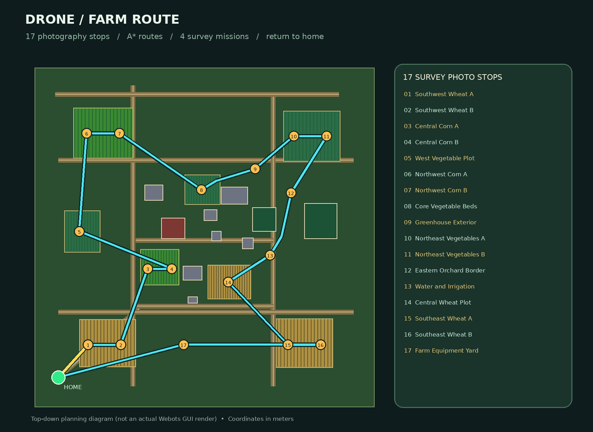
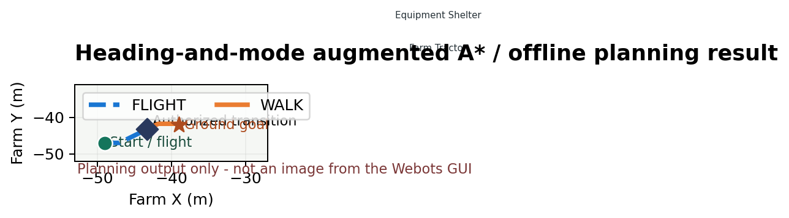

<div align="center">

# 🚁 Bio-Inspired Hybrid UAV

### Legged · Wheeled · Flying agricultural survey drone — simulated in Webots


**A single UAV that rolls on wheels, walks on four legs, then takes off and surveys a farm — all inside one Webots world.**


<i>Planned farm survey route — 17 stops, 0.75 m planning grid.</i>

<br><br>

[🚀 Quick Start](#-quick-start) ·
[🌍 Worlds](#-worlds) ·
[🎮 Controls](#-controls) ·
[📁 Project Structure](#-project-structure) ·
[🧪 Testing](#-testing) ·
[📚 Documentation](#-documentation) ·
[⚠️ Scope & Limitations](#-scope-and-limitations)

</div>

---

## ✨ Highlights

| | |
| --- | --- |
| 🦿 **Three locomotion modes** | Roll on wheels, walk on four legs, or fly — switch mid-mission with a single key. |
| 🗺️ **Autonomous navigation** | Known-map 2D A* planning, waypoint editing, obstacle placement and live route replanning. |
| 📸 **4K survey capture** | Dual survey cameras shoot **3840 × 2160** frames at every stop; a full mission writes ~35 images. |
| 🌾 **17-stop farm mission** | Rolls to an inspection point, grabs a ground image, takes off, surveys 17 stops, returns and lands. |
| 🛬 **Terrain-aware landing** | Depth-based ground assessment returns `SAFE` / `UNSAFE` / `NO_DATA` before allowing descent. |
| 📡 **Live sensor bridge** | TCP stream of IMU, LiDAR, RGB and GPS to a browser dashboard at `127.0.0.1:15882`. |
| 🔁 **ROS 2 ready** | Optional `drone_ros_bridge` package for Ubuntu / WSL2 Humble publishing. |
| ✅ **75 offline tests** | Planning, routes, perception, telemetry and wheel/leg logic run without launching Webots. |

---

## 🚀 Quick Start

**Requirements:** Windows 11 · [Webots R2025a](https://cyberbotics.com/) · Python 3 (plus Tkinter for the route editor)

```powershell
# 1. Clone
git clone https://github.com/jakir-hossen-4928/BioInspiredHybridUAV.git
cd BioInspiredHybridUAV

# 2. Verify the offline suite
python -m unittest discover -s Drone/tests -v

# 3. Run the demo
.\Drone\RUN_DEMO.bat
```

> 💡 Or open [Drone/worlds/hybrid_wheels.wbt](Drone/worlds/hybrid_wheels.wbt) directly in Webots via **File → Open World**, then press **Reset** and **Real-time**.

### Docker setup for ROS 2, FAST-LIVO2 and Hybrid A*

Use Windows PowerShell from the cloned repository root, with Webots R2025a, Python 3 and Docker running Linux containers. Close any TCP monitor using port `15882`. Build the tested U-AMC FAST-LIVO2 revision and start a local Humble container. The first build downloads and compiles the estimator dependencies.

```powershell
docker build -t farm-fast-livo:humble "https://github.com/U-AMC/FAST-LIVO2-ROS2.git#a09599a288c56b832114d7ad9e898248a4111d9e"
docker run -d --name farm-livo -p 127.0.0.1:15882:15882 farm-fast-livo:humble sleep infinity
docker cp Drone/ros2_ws/src farm-livo:/tmp/src
docker cp Drone/integration/ros2/prepare_fast_config.py farm-livo:/tmp/prepare_fast_config.py
docker exec farm-livo bash -c 'apt-get update && apt-get install -y --no-install-recommends ros-humble-demo-nodes-cpp python3-yaml'
docker exec farm-livo bash -c 'source /opt/ros/humble/setup.bash && source /fast_livo_ws/install/setup.bash && cd /tmp && colcon build --packages-select drone_ros_bridge && python3 prepare_fast_config.py --upstream /fast_livo_ws/src/fast_livo --output /tmp/farm-config'
```

Start the bridge and estimator in the first terminal. For later sessions, start the existing container with `docker start farm-livo` and repeat this launch command.

```powershell
docker exec -it farm-livo bash -c 'source /opt/ros/humble/setup.bash && source /fast_livo_ws/install/setup.bash && source /tmp/install/setup.bash && ros2 launch drone_ros_bridge fast_livo2.launch.py mid360_params_file:=/tmp/farm-config/mid360_webots.yaml camera_params_file:=/tmp/farm-config/camera_webots.yaml use_rviz:=false'
```

When the receiver reports it is listening, open a second PowerShell terminal in the repository root. Run the launcher below and press Play in Webots. Look for `[HYBRID A*] rolling poses:` in the controller console. Check each ROS topic rate in turn, pressing Ctrl+C between checks.

```powershell
.\Drone\RUN_ROS2_DEMO.bat
docker exec -it farm-livo bash -c 'source /opt/ros/humble/setup.bash && ros2 topic hz /aft_mapped_to_init'
docker exec -it farm-livo bash -c 'source /opt/ros/humble/setup.bash && ros2 topic hz /cloud_registered'
```

Restart the estimator after resetting the Webots clock. To finish, press Ctrl+C in the launch terminal and run `docker stop farm-livo`.

**Kiri on Windows.** Start Kiri and check `docker context show`. The validation run used the `kiri` context. If a different context is active, use `docker context use kiri` before running the Docker commands above.

**Webots and ROS 2 results, 24 November 2026.** The wheel mission reached `LANDED` at 196.024 simulated seconds, with 27,107 bridge packets sent and zero reported drops. The controller used the Supervisor pose. FAST-LIVO2 produced odometry and registered clouds, but its airborne position diverged. Six near-synchronous odometry/reference pairs from 5.208 to 123.288 s had a rigidly aligned position RMSE of **1,036.5 m** (no scale adjustment, maximum timestamp difference 0.208 s). The [six checkpoint pairs](Drone/docs/fast_livo2_webots_checkpoints.jsonl) include the original timestamps and positions in metres. A full-trajectory benchmark and a surveyed map comparison remain open.

**State-Augmented Hybrid A*.** For a requested flight-to-walk transition the planner searches continuous ground arcs, horizontal flight segments and vertical transitions at approved cells. Each pose stores position, yaw and mode. Flight and walking each use a fixed height, with collision checks against the inflated planar grid. The controller accepts a descent only at its terrain-screened current site. Tests exercise both search directions, height changes and rejection without an approved site. In a separate Webots walking-world run, the controller descended from 13.0 m to 0.6 m, walked to the inspection point, resumed flight and landed at 218.024 simulated seconds. The autonomous wheel survey uses a separate rolling planner and flight waypoint controller. Full 3D clearance and integrated research-design acceptance remain open.


### Launcher cheat sheet

| Script | Does what |
| --- | --- |
| [RUN_DEMO.bat](Drone/RUN_DEMO.bat) | Main wheel-drive → flight demonstration |
| [RUN_OFFLINE_TESTS.bat](Drone/RUN_OFFLINE_TESTS.bat) | Runs the full offline test suite from `Drone/` |
| [RUN_ROS2_DEMO.bat](Drone/RUN_ROS2_DEMO.bat) | Opens `hybrid_wheels_ros2.wbt` with the ROS 2 bridge |
| [editor.bat](Drone/editor.bat) | Map-based waypoint editor (save, then press `U` in Webots) |
| [sensors.bat](Drone/sensors.bat) | Live sensor dashboard in the browser |
| [photos.bat](Drone/photos.bat) | High-resolution camera world (GPU heavy) |
| [start.bat](Drone/start.bat) | Launch the base farm scene |
| [rebuild.bat](Drone/rebuild.bat) | ⚠️ Regenerates world files from geometry scripts — backs up to `world_backups/` first |
| [OPEN_SOURCE_CODE.bat](Drone/OPEN_SOURCE_CODE.bat) | Opens the project in VS Code |

---

## 🌍 Worlds

All under [Drone/worlds/](Drone/worlds/).

| World | Locomotion | What starts with |
| --- | --- | --- |
| [hybrid_wheels.wbt](Drone/worlds/hybrid_wheels.wbt) | 🛞 Wheels → ✈️ Flight | Wheel drive, inspection, flight survey — **the default demo** |
| [hybrid.wbt](Drone/worlds/hybrid.wbt) | 🦿 Legs → ✈️ Flight | Four-leg walking, inspection, flight survey |
| [farm.wbt](Drone/worlds/farm.wbt) | ✈️ Flight only | Survey with the default viewpoint |
| `overview.wbt`, `follow.wbt`, `closeup.wbt`, `top.wbt`, `photos.wbt` | ✈️ Flight only | Farm survey camera and viewpoint variants |
| [livo2.wbt](Drone/worlds/livo2.wbt), `livo2_fast.wbt` | ✈️ Flight only | FAST-LIVO2 sensor-stream variants |
| [hybrid_ros2.wbt](Drone/worlds/hybrid_ros2.wbt), [hybrid_wheels_ros2.wbt](Drone/worlds/hybrid_wheels_ros2.wbt) | 🦿/🛞 → ✈️ | Same demos with the ROS 2 bridge enabled |

---

## 🎮 Controls

Click the 3D view while the simulation runs, then press keys.

### Flight & mission

| Key | Action |
| --- | --- |
| `W` / `I` | Walk / take off and resume flight in the hybrid worlds |
| `T` | Roll in the wheel worlds · take off from landed in flight-only worlds |
| `M` / `N` / `G` | Cycle mission preset / skip a survey stop / return home |
| `O` / `R` / `V` | Toggle mapped test obstacle / replan / toggle route overlay |
| `D` / `Y` / `Z` | Toggle hybrid sonar handling / inspect terrain / request terrain-checked landing |
| `+` / `−` and `H` / `J` | Adjust flight speed and altitude |
| `U` | Reload the saved manual route |

### Cameras & capture

| Key | Action |
| --- | --- |
| `C` / `B` | Capture downward / front image in the configured format |
| `K` / `F` | Capture downward / front PNG |
| `A` / `P` | Toggle automatic photos / pause or resume UAV motion |

> 💡 Air-to-ground mode requests depend on the site's depth assessment and an available ground route. Use `hybrid.wbt` to demonstrate walking from startup. Close camera overlays when they hide the farm.

---

## 📁 Project Structure

```
BioInspiredHybridUAV/
├── README.md
├── .gitignore
└── Drone/
    ├── controllers/
    │   ├── drone/          # drone.py · planner.py · hybrid_planner.py
    │   │                   # terrain_perception.py · console_telemetry.py
    │   │                   # fast_livo_stream.py · livo_protocol.py
    │   │                   # settings.json · scene.json · manual_mission.json
    │   ├── hybrid/         # hybrid.py      — four-leg walking
    │   └── wheels/         # wheels.py      — wheel-driven rolling
    ├── worlds/             # 12 Webots .wbt worlds
    ├── textures/           # 4K farm-wood and terrain textures
    ├── tools/              # path_editor.py · farm_geometry.py
    │                       # create_worlds.py · add_wheels_worlds.py
    ├── tests/              # offline unittest suite
    ├── docs/               # 15 markdown guides + screenshots + evidence
    ├── integration/        # monitor.py / monitor.bat — TCP sensor bridge
    ├── ros2_ws/src/drone_ros_bridge/   # ROS 2 Humble package
    ├── captures/           # per-session images, telemetry, galleries
    ├── dashboard.html      # live sensor dashboard (refreshed during runs)
    └── *.bat               # 20+ one-click launchers
```

---

## ⚙️ Configuration

| File | Controls |
| --- | --- |
| [settings.json](Drone/controllers/drone/settings.json) | Speed, altitude, clearance, photo options, sensor streaming, landing thresholds |
| [scene.json](Drone/controllers/drone/scene.json) | Field boundaries, home point, mapped obstacles, survey stops, mission presets |
| [manual_mission.json](Drone/controllers/drone/manual_mission.json) | Custom route written by the waypoint editor |

**Default survey parameters** — 0.75 m planning grid · 1.2 m clearance · 3.8 m/s flight speed · 13 m altitude · 4 s waypoint holds.

Reload the world after changing any of these.

### Outputs

Each run writes to [Drone/captures/](Drone/captures/):

- `MISSION_GALLERY.html` — browsable photo gallery
- `photo_manifest.csv` — stop IDs and camera names
- `CONSOLE_TELEMETRY.jsonl` / `SENSOR_TELEMETRY.csv` — full telemetry
- `hybrid_status.json` — mode transitions and final landing
- 4K PNG/JPG frames, tagged `GROUND_INSPECTION` for the pre-flight image

> ⚠️ A default hybrid survey uses several hundred MB. `capture_front_also` and `photo_format` control future output size — archive old runs you no longer need.

---

## 🧪 Testing

```powershell
python -m unittest discover -s Drone/tests -v
```

| Metric | Value |
| --- | --- |
| Coverage | Navigation, perception, routes, hybrid modes, wheel arcs, telemetry, sensor transport, ROS 2 packaging and local estimator math |
| Tests | **75 passed** with PyYAML installed. The calibration configuration test skips when PyYAML is unavailable. |
| Runtime | ~5 s |
| Webots required | No — uses mocked Webots objects and synthetic depth arrays |

| Module | Covers |
| --- | --- |
| [test_navigation.py](Drone/tests/test_navigation.py) | A* occupancy-grid planning and replanning |
| [test_perception.py](Drone/tests/test_perception.py) | Depth-based ground-plane fit and landing decisions |
| [test_routes.py](Drone/tests/test_routes.py) | Manual waypoint validation and mission presets |
| [test_hybrid.py](Drone/tests/test_hybrid.py) / [test_wheels.py](Drone/tests/test_wheels.py) | Mode transitions for walking and rolling |
| [test_console_telemetry.py](Drone/tests/test_console_telemetry.py) | Telemetry logging and state formatting |
| [test_livo_stream.py](Drone/tests/test_livo_stream.py) | FAST-LIVO2 sensor stream framing |
| [test_ros2_package.py](Drone/tests/test_ros2_package.py) | ROS 2 bridge packaging (skips without PyYAML) |

See [Drone/docs/testing.md](Drone/docs/testing.md) for what these tests do **not** prove.

---

## 📸 Screenshots

| Architecture | Route plan | Path editor |
| --- | --- | --- |
|  |  |  |

| Hybrid planning preview |
| --- |
|  |

> ℹ️ Full-resolution survey frames from real runs live in [Drone/captures/](Drone/captures/) — open the latest `MISSION_GALLERY.html` to browse them.

---

## 📚 Documentation

### 🔧 Getting started
| Guide | Description |
| --- | --- |
| [Drone/docs/guide.md](Drone/docs/guide.md) | Setup, launchers, editable parameters, output data |
| [Drone/README_START_HERE.txt](Drone/README_START_HERE.txt) | Original merged-project walkthrough |
| [Drone/docs/testing.md](Drone/docs/testing.md) | What the test suite verifies — and what it does not |
| [Drone/README_VALID_ZIPS.txt](Drone/READ_ME_VALID_ZIPS.txt) | Integrity notes for the source archives |

### 🦿 Locomotion & worlds
| Guide | Description |
| --- | --- |
| [Drone/README_WHEELS.md](Drone/README_WHEELS.md) | Wheel-drive mode |
| [Drone/docs/FLIGHT_WALK_SETUP.md](Drone/docs/FLIGHT_WALK_SETUP.md) | Flight and walking setup |
| [Drone/docs/WHEEL_LEGS_DEMO.md](Drone/docs/WHEEL_LEGS_DEMO.md) | Combined wheel + leg demonstration |
| [Drone/docs/WHEEL_QA_SUMMARY.md](Drone/docs/WHEEL_QA_SUMMARY.md) | Wheel-mode QA notes |

### 📡 Sensors, ROS 2 & SLAM
| Guide | Description |
| --- | --- |
| [Drone/docs/specifications.md](Drone/docs/specifications.md) | Per-sensor status: what works, what is approximated, what is missing |
| [Drone/docs/SENSOR_MOUNTS.md](Drone/docs/SENSOR_MOUNTS.md) | Sensor placement |
| [Drone/docs/ROS2_CONNECTION.md](Drone/docs/ROS2_CONNECTION.md) | Ubuntu/WSL2 ROS 2 bridge setup |
| [Drone/README_ROS2.md](Drone/README_ROS2.md) | ROS 2 overview |
| [Drone/README_CONSOLE_DEMO.txt](Drone/README_CONSOLE_DEMO.txt) | Console-only demonstration |
| [Drone/docs/FAST_LIVO2_SETUP.md](Drone/docs/FAST_LIVO2_SETUP.md) | External FAST-LIVO2 estimator setup |
| [Drone/docs/FAST_LIVO2_VALIDATION.md](Drone/docs/FAST_LIVO2_VALIDATION.md) | What has and has not been validated |
| [Drone/docs/4k_quality.md](Drone/docs/4k_quality.md) | 4K texture and image quality notes |

### 📈 Project status
| Guide | Description |
| --- | --- |
| [Drone/docs/PROGRESS_2026-11-21.md](Drone/docs/PROGRESS_2026-11-21.md) | Latest progress log |
| [Drone/docs/PROFESSOR_STATUS.md](Drone/docs/PROFESSOR_STATUS.md) | Supervisor-facing status |
| [Drone/docs/UPGRADE_NOTES.md](Drone/docs/UPGRADE_NOTES.md) | Upgrade notes |
| [Drone/docs/report.docx](Drone/docs/report.docx) | Word-format project report |

---

## 🧭 Optional Sensor Bridge

```powershell
.\Drone\integration\monitor.bat
```

The TCP monitor listens on `127.0.0.1:15882`, reports IMU, LiDAR, RGB and GPS counts, and writes samples to [Drone/integration/recordings/](Drone/integration/recordings/).

- ROS 2 publishing → [Drone/docs/ROS2_CONNECTION.md](Drone/docs/ROS2_CONNECTION.md)
- External estimator → [Drone/docs/FAST_LIVO2_SETUP.md](Drone/docs/FAST_LIVO2_SETUP.md)
- Source → [Drone/ros2_ws/src/drone_ros_bridge/](Drone/ros2_ws/src/drone_ros_bridge/)

A disconnected receiver never stops the local mission.

---

## ✅ Verification on This PC

| Webots run | First logged landing | Survey output |
| --- | --- | --- |
| 🛞 Wheel drive → ✈️ flight | 196.05 simulated seconds, **0.091 m** from home | 17 stops, 35 decodable 3840 × 2160 PNGs |
| 🦿 Leg walking → ✈️ flight | 198.05 simulated seconds, **0.091 m** from home | 17 stops, 35 decodable 3840 × 2160 PNGs |

The wheel run confirms the corrected 0.60 m model landing height and the `GROUND_INSPECTION` label. The walking run predates those two changes. The local TCP monitor received live IMU, LiDAR, RGB and GPS data and wrote a camera sample plus a point cloud.

---

## 📌 Scope and Limitations

This repository is honest about what it does and does not demonstrate. Read [Drone/docs/specifications.md](Drone/docs/specifications.md) for the full matrix.

| Area | Reality |
| --- | --- |
| Locomotion | Wheels, walking and flying are **Supervisor-kinematic visual demonstrations**. There is no wheel traction model and no validated leg force. |
| Foot force | Four force-3d device nodes exist; their Newton outputs are **not physically validated**. |
| Localization | Known simulated GPS pose only — **no visual-inertial localization**. |
| Mapping | Small observed ground-height grid from depth — **not SLAM**. |
| LiDAR | Generic Webots range scan; the exact Livox Mid-360 scan pattern is not modelled. |
| Barometer | ISA pressure derived from the altimeter, not a pressure sensor model. |
| FAST-LIVO2 | The external estimator ran on simulated data. Substantial airborne drift limits trajectory and map accuracy. |
| Navigation | Rolling uses bounded-curvature Hybrid A*. Standalone walking uses a heading-aware grid. The screened descent uses land-air Hybrid A*. Aerial survey uses known-map 2D A*. |
| Landing check | Educational heuristic assuming a vertical sensor and a `Z=0` farm ground reference. Thresholds need tuning per scene. **It cannot guarantee real-world safe landing.** |

> Offline tests and ZIP integrity are **not** proof of Webots GUI behaviour, tire-ground friction, leg forces or ROS 2 estimator correctness. Capture real screenshots and metrics from `farm.wbt` before reporting results.

---

## 🔧 Troubleshooting

| Symptom | Check |
| --- | --- |
| 🩷 Pink checkerboards | Open the world from inside the assembled project and confirm matching files exist in `Drone/textures/`. |
| Controller stops / scene frozen | Switch to **Real-time**, open **View → Console** for the first traceback, confirm Webots uses the intended Python executable. |
| `No Project` on world open | Open the world from inside `Drone/worlds/` rather than a detached copy. |
| Test obstacle refused | Press `O` on a longer flight leg so the controller has room to place it. |
| Air-to-walk or air-to-roll rejected | Press `Y` to see the depth assessment — a safe footprint and usable ground route are required. |
| TCP status says disconnected | Start the monitor or ROS 2 receiver **before** the world. |
| Webots can't start the controller | Set its Python command in **Tools → Preferences → General** to your installed Python, then reopen the world. |

---

## 🗂️ Report Scope

| Design report section | Workspace coverage |
| --- | --- |
| §4.3 Webots navigation | ✅ Farm, known-map 2D A*, waypoint editing, obstacle replanning, survey images, return-home. Leg and wheel demonstrations extend the sandbox. |
| §4.2 Structure, wing folding, flight/leg dynamics | 🔬 MATLAB studies and URDF are separate inputs; the Webots quadcopter models locomotion visually. |
| §4.4–4.7 IoT, crop-health AI, fusion, visitor routing, dashboards | 🔬 Separate subsystem experiments requiring their own source, datasets and model weights. The local Webots dashboard shows sensor telemetry. |
| FAST-LIVO2 and physical KPIs | 🔬 The TCP bridge supplies simulated measurements. Estimator convergence, power, thrust, contact force and tracking accuracy need separate validation. |

---

<div align="center">

**Built with** [Webots](https://cyberbotics.com/) · Python 3 · ROS 2 Humble

</div>
